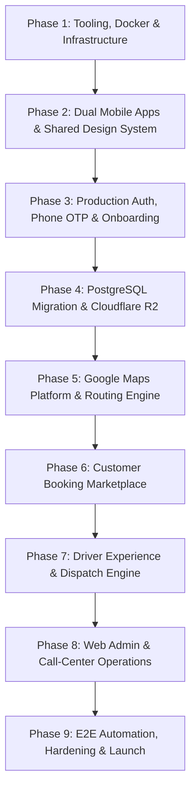

# KULI Logistics — Mobile Apps Separation, Lalamove Modernization & Master Execution Plan

**Author:** Antigravity AI Engineering
**Date:** October 2026
**Status:** Approved Master Architecture & Implementation Plan
**Target Applications:**
1. **KULI Customer App** (Mobile Booking, Moving & Freight Transport)
2. **KULI Driver App** (Independent Truck Owners, Fleet Drivers & Operations)
3. **KULI Web Operations Console** (Call-Center Assistant & Administration)
4. **KULI Backend API** (Modular Monolith, PostgreSQL, Supabase, Cloudflare R2, Google Maps)

---

## 1. Executive Summary & Strategic Architecture Decisions

This plan outlines the end-to-end modernization of the KULI Logistics Platform, inspired by the gold-standard user experience, booking funnel, and operational efficiency of **Lalamove** (alongside best-in-class dispatch and driver execution patterns from **Onfleet** and **Routific**), tailored specifically to the unique transport ecosystem of Addis Ababa and East Africa.

### Major Architectural Decisions

| Decision | Selection | Rationale & Implementation Details |
|---|---|---|
| **1. Mobile App Architecture** | **Dual Mobile Apps** (Customer App + Driver/Owner App) | Rather than a single monolithic mobile binary with runtime role branching, KULI scales into two dedicated mobile app targets (`@kuli/customer-mobile` and `@kuli/driver-mobile`). Both apps share design tokens, authentication modules, API client, and UI components via shared monorepo packages, but ship with role-tailored navigation, optimized bundle sizes, and dedicated permissions (e.g. background driver GPS vs customer foreground map). |
| **2. Map & Routing Engine** | **Google Maps Platform** | Transition all map, geocoding, autocomplete, and routing services to Google Maps Platform (Maps SDK for iOS/Android, Places API New, Routes API, Geocoding API). Abstracted behind a strict server-side `MapsProvider` interface with robust Addis Ababa landmark/neighborhood fallbacks and manual pin selection. |
| **3. Primary Database** | **PostgreSQL (Supabase in Prod, Docker in Dev)** | Migrate domain persistence from MongoDB to PostgreSQL. PostgreSQL provides ACID relational transactions for critical financial settlements, offer-acceptance concurrency (atomic row locking for first-accept-wins), and native PostGIS geospatial querying. In production, Supabase provides managed PostgreSQL + Auth. In local dev, Docker Compose orchestrates PostgreSQL 16. |
| **4. Object Storage** | **Cloudflare R2** | Replace MongoDB GridFS with Cloudflare R2 (S3-compatible, zero egress fees). All driver verification documents (national ID, driving license, commercial vehicle registration, insurance) and trip proof photos/signatures are stored in private R2 buckets, accessible only via short-lived pre-signed URLs generated by the API. |
| **5. Developer Experience & CI** | **Docker Compose + `run.sh` + E2E Test Suite** | Professionalize the repository with a comprehensive `docker-compose.yml` (PostgreSQL 16, Redis 7, and migration bridge), an interactive CLI `run.sh` script, standardized `.env.example` templates, and a dedicated `tests/` directory with automated integration and E2E suites. |
| **6. Authentication & Identity** | **Phone-First Identity with Supabase Auth** | Phone numbers are the primary identifier for Ethiopian logistics. Mandatory phone validation during registration with a searchable country code selector (defaulting to Ethiopia `+251`), verified via SMS OTP before full account activation. Driver onboarding routes to vehicle document submission; customer onboarding is friction-free. |

---

## 2. Benchmark Blueprint: Deconstructing Lalamove

Based on extensive reverse engineering and UI/UX benchmarks of the Lalamove mobile ecosystem:

```
+-----------------------------------------------------------------------------------+
|                              LALAMOVE CORE PATTERNS                               |
+-----------------------------------------------------------------------------------+
|  1. Visual Entry:                                                                 |
|     - Clean branded hero with delivery vehicle illustration & warm brand tones.    |
|     - Prominent dual CTA: "Log In" (Primary) and "Register" (Secondary Outline).   |
|                                                                                   |
|  2. Customer Booking Funnel:                                                      |
|     - Instant pickup & drop-off address picker with interactive map pin & hints.  |
|     - Visual vehicle selector carousel (Motorcycle, Van, 1-Ton, 3-Ton, Isuzu).    |
|     - Upfront guaranteed price breakdown before booking dispatch.                 |
|     - Order timeline: Finding Driver -> Driver Assigned -> En Route -> Delivered. |
|                                                                                   |
|  3. Driver Task Board:                                                            |
|     - Online/Offline toggle with real-time location pinging.                      |
|     - Expiring incoming job card with route distance, earnings, and cargo notes.  |
|     - Multi-state trip progress: "Slide to Arrive" -> "Slide to Complete".        |
|     - Cash collection confirmation dialog with dispute protection.                |
|                                                                                   |
|  4. Onboarding Divergence:                                                        |
|     - Customer: Instant signup -> Phone OTP -> Instant booking.                   |
|     - Driver: Signup -> Phone OTP -> Vehicle & License Document Upload -> Admin   |
|       Verification Queue -> Mandatory Approval before Going Online.               |
+-----------------------------------------------------------------------------------+
```

---

## 3. Phased Implementation Roadmap

To deliver this platform professionally without risky big-bang rewrites, work is structured into nine distinct, testable phases:



---

### Phase 1: Tooling, Docker & Infrastructure (Immediate / Current)

**Objective:** Equip the repository with professional local infrastructure, unified execution scripts, environment templates, and integration test foundations.

- [x] **Docker Compose Setup (`docker-compose.yml`)**:
  - Add PostgreSQL 16 container (`kuli-postgres`) on port 5432 with healthchecks and persistent volumes.
  - Maintain Redis 7 (`kuli-redis`) on port 6380 for rate limiting, cache, and upcoming job queues.
  - Retain MongoDB on 27018 during the phased migration window.
- [x] **Professional Run Script (`run.sh`)**:
  - Executable bash CLI with colored output supporting:
    - `./run.sh help` — Command overview.
    - `./run.sh dev:api` — Start backend API with hot reload.
    - `./run.sh dev:customer` — Start customer mobile app in Expo.
    - `./run.sh dev:driver` — Start driver mobile app in Expo.
    - `./run.sh dev:admin` — Start admin web dashboard.
    - `./run.sh dev:landing` — Start marketing landing page.
    - `./run.sh docker:up` / `docker:down` / `docker:status` — Orchestrate local containers.
    - `./run.sh test` — Run all unit and integration test suites.
    - `./run.sh test:auth` — Run dedicated authentication and role security tests.
    - `./run.sh lint` / `./run.sh typecheck` — Run repository quality gates.
- [x] **Environment Configuration Templates (`.env.example`)**:
  - Centralize all Google Maps variables (`GOOGLE_MAPS_SERVER_API_KEY`, `MOBILE_APP_GOOGLE_MAPS_API_KEY`, `ADMIN_APP_GOOGLE_MAPS_API_KEY`).
  - Add PostgreSQL connection strings (`DATABASE_URL`, `POSTGRES_USER`, `POSTGRES_PASSWORD`, `POSTGRES_DB`).
  - Add Cloudflare R2 object storage variables (`R2_ACCOUNT_ID`, `R2_ACCESS_KEY_ID`, `R2_SECRET_ACCESS_KEY`, `R2_BUCKET_NAME`, `R2_PUBLIC_URL`).
  - Add SMS provider configuration for Ethiopian telecommunications.
- [x] **Dedicated Test Directory (`tests/`)**:
  - Establish `tests/auth/` and `tests/integration/` test suites integrated with `npm test`.

---

### Phase 2: Dual Mobile Apps & Shared Design System (Immediate / Current)

**Objective:** Establish clean separation between the Customer and Driver apps, supported by a shared design token system and reusable UI components conforming to KULI Brand Guidelines and Lalamove ergonomics.

- [x] **Shared Design Tokens & Themes (`apps/mobile/src/auth/theme/`)**:
  - **Light Theme (Daylight Optimized)**:
    - Primary Navy Blue: `#1F3B87`
    - Midnight Navy: `#142553`
    - Warm Amber Orange: `#FFAD61` (hover/active: `#FFA24B`)
    - Cargo Sky Blue: `#77ACF1`
    - Background Canvas: `#FBFAF9`
    - Card Surfaces: `#FFFFFF`
    - Charcoal Text: `#191818` (WCAG AAA compliant: 15.22:1 on background)
  - **Dark Theme (Accessible High-Contrast)**:
    - Background Canvas: `#0F172A`
    - Card Surface: `#1E293B`
    - Primary Navy Accent: `#3B82F6`
    - Warm Accent: `#F59E0B`
    - Text Primary: `#F8FAFC`
  - Pill radii (`24px–32px`), generous touch targets (`min 48×48px`), clean input borders.
- [x] **Dual App Configuration (`apps/mobile/app.config.js`)**:
  - Support `KULI_APP_VARIANT=customer` (App Name: "KULI", Bundle ID: `com.kuli.customer`, Scheme: `kuli`).
  - Support `KULI_APP_VARIANT=driver` (App Name: "KULI Driver", Bundle ID: `com.kuli.driver`, Scheme: `kuli-driver`).
  - Dedicated package scripts: `npm run dev:customer` and `npm run dev:driver`.

---

### Phase 3: Authentication, Phone OTP & Onboarding (Current Deliverable)

**Objective:** Implement the complete, secure, Lalamove-inspired authentication and profile lifecycle across both mobile apps.

- [x] **Searchable Country Code Selector**:
  - 70+ international countries with flag emojis, dial codes, and search indexing.
  - Default to Ethiopia (`+251`, 🇪🇹).
  - Searchable modal bottom sheet with instant filter and accessible item selection.
- [x] **Mandatory Phone Validation**:
  - Valid phone number required for all public registrations.
  - Strict Ethiopian mobile format validation (`+251 9...` or `+251 7...`, 9 digits) and international E.164 normalization.
  - Informative inline formatting hint and helper text.
- [x] **Comprehensive Screen Suite**:
  1. `LoginScreen`:
     - Phone number (with country code picker) or Email identifier toggle.
     - Password input with secure show/hide visibility toggle.
     - "Forgot password?" recovery link.
     - Primary "Log In" button + Secondary "Register" button.
     - "Continue with Google" social login integration.
     - Terms of Service & Privacy Policy footer links.
  2. `SignupScreen`:
     - Clear role cards: "Customer / Client" (Book moves) vs "Driver / Truck Owner" (Earn with truck).
     - Full Name input.
     - Searchable Country Code + Phone input.
     - Email address input.
     - Password & Confirm Password with live security requirements checklist (8+ chars, uppercase, lowercase, number/symbol, matching).
     - Terms & Conditions consent checkbox.
     - "Create Account" submission button.
  3. `OtpVerificationScreen`:
     - Displays masked destination phone number.
     - 6-digit PIN input with auto-advance, backspace, and paste support.
     - Dynamic resend countdown timer (e.g. 60 seconds).
     - Explicit screen states:
       - **Loading / Checking state**: Spinner and disabled button.
       - **Expired code state**: Clear notice with one-tap resend.
       - **Incorrect code state**: Red validation alert with input highlight.
       - **Network failure state**: Offline/connection error alert with retry button.
       - **Disabled state**: Block submission until all 6 digits are provided.
       - **Success state**: Confirmed activation transition.
       - **Back / Edit**: "Change phone number" option.
  4. `ProfileCompletionScreen` / `OnboardingRouter`:
     - **Customer flow**: Instant welcome screen -> direct transition to booking map.
     - **Driver flow**: Account created notice -> Informs driver that vehicle registration and document upload (Driver License, Commercial Registration, Insurance) are required -> Routes to vehicle onboarding.
  5. `PasswordRecoveryScreen`:
     - Step 1: Request reset code via verified email or phone.
     - Step 2: Verify 6-digit recovery OTP with countdown.
     - Step 3: Choose new secure password with live checklist.
  6. `ChangePasswordScreen` (Authenticated):
     - For logged-in users in settings/profile.
     - Current password verification, new password input, strength checklist, error/success feedback.
- [x] **Security & Rate Limiting Guardrails**:
  - Client and server-side rate-limiting on OTP requests (cooldown timer + maximum attempt threshold).
  - Safe duplicate phone number handling (conflict detection without sensitive user enumeration).
  - Supabase Auth verification tokens strictly validated on backend; client-supplied roles never trusted.
- [x] **Automated Test Suite**:
  - `tests/auth/phone-validation.test.mjs`: Tests for phone normalization, country codes, Ethiopian mobile rules.
  - `tests/auth/auth-workflow.test.mjs`: Tests for signup, duplicate phone rejection, invalid/expired OTPs, login, password recovery, change password, and rate limiting.
  - `tests/integration/role-access.test.mjs`: Tests for role-based endpoint security (unauthorized driver task access, unverified driver availability, unauthenticated password updates).

---

### Phase 4: Data Layer Modernization: PostgreSQL & Cloudflare R2

**Objective:** Transition core persistence to PostgreSQL (Supabase in production, Docker in dev) and file storage to Cloudflare R2.

- **PostgreSQL Relational Schema Design**:
  - `users`: ID, supabase_user_id (unique), role, account_status, full_name, email, phone (unique), created_at, updated_at.
  - `vehicles`: ID, owner_id (FK), vehicle_class_id (FK), license_plate (unique), make, model, year, capacity_tons, volume_cbm, verification_status, availability_status, current_location (PostGIS Geometry Point), created_at.
  - `vehicle_documents`: ID, vehicle_id (FK), document_type, r2_key, status, review_notes, reviewed_at.
  - `booking_requests`: ID, client_id (FK), status, pickup_location (Point), pickup_address, dropoff_location (Point), dropoff_address, vehicle_class_id, quote_snapshot (JSONB), cargo_details (JSONB), scheduled_at, created_at.
  - `trip_offers`: ID, request_id (FK), vehicle_id (FK), owner_id (FK), status, expires_at, created_at.
  - `trip_status_events`: ID, request_id (FK), actor_id (FK), previous_status, new_status, metadata, created_at.
  - `payments`: ID, request_id (FK), amount, currency, method, status, confirmed_by_id, confirmed_at.
  - `ratings`: ID, request_id (FK), reviewer_id (FK), target_id (FK), score, comments, created_at.
  - `reports`: ID, reporter_id (FK), target_user_id, request_id, category, description, status, resolution.
  - `audit_logs`: ID, actor_id, action, target_type, target_id, details (JSONB), created_at.
- **Concurrency & Integrity**:
  - Use `SELECT ... FOR UPDATE` row-level locks on `trip_offers` and `booking_requests` to guarantee atomic first-accept-wins matching.
- **Cloudflare R2 Integration**:
  - `@aws-sdk/client-s3` configured with Cloudflare R2 endpoint.
  - Private buckets with short-lived pre-signed URLs for document upload and authorized admin review.
  - Automatic mime-type validation and file size limits (max 10MB for photos, 15MB for documents).

---

### Phase 5: Google Maps Platform Integration & Location Engine

**Objective:** Implement production-grade mapping, search, and routing across all surfaces using Google Maps Platform.

- **Server-Side `MapsProvider` Interface**:
  - `geocode(addressString)`: Converts address/landmark to lat/lng.
  - `reverseGeocode(lat, lng)`: Converts coordinates to readable place name.
  - `getRoute(origin, destination, options)`: Returns road distance in meters, duration in seconds, and encoded polyline from Google Routes API.
  - `getRouteMatrix(origins, destinations)`: Batch distance/time calculation for candidate matching.
- **Addis Ababa Address Resilience**:
  - Google Places Autocomplete (New) with location restriction to Addis Ababa bounds.
  - Support for local landmark entry, sub-city/woreda descriptions, and manual pin adjustment.
  - Structured pickup instructions: Building name, gate number, floor, contact person phone.
- **Client & Driver Map Experience**:
  - Interactive map view with smooth camera animations and custom SVG markers.
  - Route preview polyline with distance and travel time pills.
  - Clear UI distinction between **Route Estimate**, **Last Reported Position**, and **Live GPS**.

---

### Phase 6: Customer Booking Marketplace (Lalamove UX)

**Objective:** Build the high-converting Lalamove-inspired customer booking journey.

- **Vehicle Category Carousel**:
  - Visual cards: Small Pickup (Pickup Truck), Medium Truck (Isuzu / 3.5 Ton), Large Truck (FSR / 7 Ton), Heavy Freight (Trailer / Sino Truck).
  - Clear capacity specs: Max weight (kg/tons), dimensions (L×W×H), cargo volume.
  - Upfront base fare + per-km rate breakdown.
- **Booking Steps**:
  1. Address Selection: Pickup and Drop-off with interactive pins and landmark instructions.
  2. Cargo & Service Options: Moving assistance (helpers required), fragile item flag, floor level/elevator access.
  3. Price Confirmation: Transparent quote summary, payment method (Cash on Delivery), promotional notes.
  4. Dispatch & Matching: Real-time search animation while finding nearby verified drivers.
  5. Live Order Tracking: Interactive status timeline with assigned driver info, vehicle plate, direct call/chat button.

---

### Phase 7: Driver Experience & Dispatch Engine

**Objective:** Deliver an empowering, intuitive mobile tool for truck owners and drivers.

- **Driver Status & Availability**:
  - Prominent "Go Online / Offline" toggle switch.
  - Active vehicle selector for fleet owners with multiple trucks.
  - Location freshness indicator.
- **Incoming Job Dispatch**:
  - Audio alert + full-screen modal for incoming offers.
  - Route map overview, pickup-to-dropoff distance, earnings in ETB, cargo type.
  - Live 60-second acceptance countdown bar.
  - One-tap "Accept Job" (with atomic backend race protection) or "Decline".
- **Trip Execution Lifecycle**:
  - Step 1: "En Route to Pickup" -> Google Maps Turn-by-Turn deep link.
  - Step 2: "Arrived at Pickup" -> Timestamped arrival log.
  - Step 3: "Loading Cargo" -> Item check.
  - Step 4: "In Transit to Destination".
  - Step 5: "Unloading".
  - Step 6: "Complete Delivery & Collect Payment" -> Cash amount confirmation dialog + optional proof photo upload.

---

### Phase 8: Web Admin & Call-Center Operations

**Objective:** Empower operations teams to verify drivers, supervise live trips, manage pricing, and handle assisted phone bookings.

- **Driver Verification Workbench**:
  - Inspection queue for new truck registrations and uploaded documents.
  - High-resolution document viewer with zoom and rotation.
  - Approve with verification badge or Reject with mandatory user notification reason.
- **Live Fleet Control Tower**:
  - Interactive Addis Ababa map displaying active trips, unassigned requests, and online trucks.
  - Incident queue for delayed trips or reported issues.
- **Hotline Booking Suite**:
  - Rapid manual booking creation for clients calling the customer support hotline.
  - Client phone number lookup with historical addresses.

---

### Phase 9: E2E Automation, Hardening & Launch

**Objective:** Comprehensive verification, load testing, security auditing, and production deployment readiness.

- **Cross-Role Integration Testing**:
  - Full automated scenario: Customer registers -> books truck -> Driver receives offer -> accepts -> completes trip -> confirms cash payment -> Customer rates driver.
- **Security & Privacy Audit**:
  - Verify zero secrets in compiled mobile bundles.
  - Enforce least-privilege PostgreSQL RLS policies.
  - Test rate limiting under simulated load.
- **Production Checklist**:
  - Configure production SMS gateway for Ethiopia (Telebirr/Ethio Telecom or international aggregator).
  - Provision production Supabase project and Cloudflare R2 bucket with custom domain.
  - Set up Sentry error tracking and Prometheus/Grafana API metrics.

---

## 4. Current Task Scope & Deliverables

In this immediate task, we execute **Phase 1, Phase 2, and Phase 3**:
1. Professionalize the repository infrastructure (`docker-compose.yml` with PostgreSQL 16 + Redis + MongoDB, `run.sh` execution script, comprehensive `.env.example` templates).
2. Configure dual mobile apps capability (`@kuli/customer-mobile` and `@kuli/driver-mobile`).
3. Build the complete, production-grade Authentication System (searchable country codes with +251 default, phone validation, Login, Signup, OTP verification with explicit states, customer/driver onboarding routing, password recovery, authenticated password change, light/dark brand themes).
4. Implement automated test suites in `tests/auth/` and `tests/integration/` validating all requirements.
5. Review the complete diff and report provider configuration and remaining steps.
