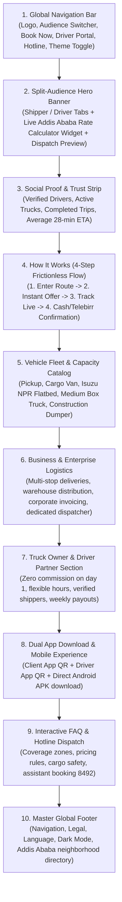

# Kulli Landing Page — Architecture, Design & Phased Implementation Plan

> **Document Status:** Planning & Design Specification (No code changes implemented in this step)  
> **Target Location:** `apps/landing` in the `kuli-logistics-platform` monorepo  
> **Brand System Reference:** `/docs/brand` (Logos, Fonts, Tokens, Contrast Matrix)  
> **Engineering Standards:** `docs/dev/AGENTS.md`  
> **Inspiration Benchmarks:** Uber (Dual-Audience Dispatch), Routific (Modern Clean Route UI), Uber Freight / Kobo360 (African Logistics Reality)

---

## Executive Summary

Kulli is an on-demand, peer-to-peer logistics and trucking marketplace engineered specifically for Addis Ababa. The platform connects individuals and businesses needing cargo, freight, furniture, and materials transport with verified, available truck owners and fleet operators.

The existing landing page in `/home/dawit/Documents/Projects/mobile-app/guide/Kulli` provided foundational business ideas (on-demand booking, vehicle types, driver recruitment, FAQ, and app download links), but suffers from:
1. **Template debt:** TeleportHQ export artifacts, leftover "Up Start Finance" boilerplate text, and dead placeholder links.
2. **Performance drag:** 9 Google Fonts loaded simultaneously (~500KB+ render-blocking CSS/fonts).
3. **Disconnected visual identity:** Generic delivery truck clipart, mismatched color names (`--dl-color-scheme-green100` holding navy blue `#1f3b87`), and inconsistent card sizing.
4. **Static presentation:** Zero interactive quote estimation, no route visualization, and no tie-in to Addis Ababa's real dispatch dynamics.

This document lays out an **Uber-grade, Routific-inspired landing page architecture** built on Kulli’s newly engineered brand system (`/docs/brand`), divided into **5 manageable, verifiable phases**.

---

## 1. Deep Benchmarking & Comparative Analysis

### 1.1 Reverse Engineering Uber Landing Page (via REA)
Inspecting Uber’s live landing page structure (`https://www.uber.com`) using Chrome DevTools Protocol revealed key architectural principles:

```
┌────────────────────────────────────────────────────────────────────────┐
│ UBER CORE LANDING ARCHITECTURE (CDP Observation)                        │
├────────────────────────────────────────────────────────────────────────┤
│ 1. Split-Audience Navigation: Ride | Drive | Eat | Freight | Business  │
│ 2. Dual-Intent Hero: Instant toggle between "Request" and "Earn"      │
│ 3. Above-the-Fold Interactive Widget:                                  │
│    - Pickup Location Input + Auto-fill                                 │
│    - Destination Location Input                                        │
│    - Date / Time Picker                                                │
│    - Dynamic "See Prices" CTA                                          │
│ 4. Clear 5-Step Customer Journey:                                      │
│    Request -> Match -> Meet Driver -> Real-time Transit -> Rate/Pay   │
│ 5. Distinct Segment Cards: Household Moves, B2B, Specialized Freight   │
│ 6. Supply-Side Recruitment Band: "Drive when you want, make extra"     │
│ 7. Ecosystem App Download: Dual QR codes for Consumer & Driver Apps    │
└────────────────────────────────────────────────────────────────────────┘
```

**Key Takeaways for Kulli:**
- **Dual-Audience Split Above the Fold:** In a two-sided logistics marketplace, forcing shippers and truck owners through identical copy causes immediate drop-off. A toggle tab (*"Need a Truck"* vs. *"Drive & Earn"*) right in the hero banner captures both sides instantly.
- **Frictionless Interactive Rate Calculator:** Rather than generic "Contact Us" or static "Book Now" buttons, letting visitors select pickup (e.g. *Merkato*) and drop-off (e.g. *Bole Medhanialem*) with an instant fare estimate drastically spikes conversion and user trust.
- **Hotline Alternative:** In Addis Ababa, a large percentage of enterprise and urgent moves happen via phone. Integrating a hotline button ("Call Assistant / 8492") bridges the digital app with Kulli's existing call-center assistant dashboard (`apps/admin`).

---

### 1.2 Routific Design System Benchmarking (`https://www.routific.com`)
Analyzing Routific's landing page revealed why its design feels exceptionally polished, trustworthy, and modern:

```
┌────────────────────────────────────────────────────────────────────────┐
│ ROUTIFIC DESIGN HIGHLIGHTS                                             │
├────────────────────────────────────────────────────────────────────────┤
│ 1. Typography: Powered by Plus Jakarta Sans (identical to Kulli Brand) │
│ 2. Software UI as the Hero:                                            │
│    - Clean vector map with non-overlapping color-coded route paths     │
│    - Live driver stop sequence tile + customer delivery tracker card   │
│ 3. Problem/Solution Framing:                                           │
│    "Tired of chaotic phone calls & broker markups?"                    │
│    -> "Clean, driver-friendly routes & upfront guaranteed pricing"     │
│ 4. Concrete Trust Metrics: "Cut delivery costs by 25%", "4.9/5 Rating" │
│ 5. Generous Whitespace: 24px-32px padding, subtle 1px border lines,   │
│    multi-layer soft shadows (4px-12px blur, 4% opacity)                │
└────────────────────────────────────────────────────────────────────────┘
```

**Key Takeaways for Kulli:**
- **Replace Clipart with Software & Dispatch Mockups:** Instead of cartoon delivery vans or generic stock photos, feature realistic UI mockups of Kulli's live route previews (OSRM map preview, pickup/drop-off route pills, driver verification badges).
- **Whitespace & Visual Breathing Room:** Move away from cluttered TeleportHQ boxes. Use the 4px base spacing scale (`--space-4` to `--space-16`) and rounded cards (`--radius-xl`).
- **Plus Jakarta Sans + Space Grotesk Synergy:** Use Space Grotesk Bold for high-impact headlines and Plus Jakarta Sans for UI labels, badges, and body copy.

---

### 1.3 What to Preserve vs. Transform from the Existing Landing Page

| Existing Element (`guide/Kulli`) | Status | Planned Evolution for Production |
|---|---|---|
| **Value Proposition** ("Ship Anything, Anytime, Everywhere") | **Preserve & Refine** | Evolve headline into Space Grotesk Display: *"Ship Anything, Anywhere Across Addis Ababa."* Pair with clear metrics: *"100% Verified Trucks • Upfront Fares • Cash or Telebirr"*. |
| **3 Service Columns** (Home/Office, B2B Logistics, Construction) | **Preserve & Modernize** | Transform from static text blocks into interactive cards featuring authentic local truck types (Bedford KB26, Isuzu NPR Flatbed, Cargo Van) with capacity specs. |
| **Driver Recruitment Section** ("Drive when you want, make extra money") | **Preserve & Elevate** | Move into a dedicated tab/band with an instant earnings calculator: *"Estimated weekly earnings with an Isuzu NPR in Addis: 18,000 – 25,000 ETB"*. |
| **Vehicle Types** (Pickup Truck, Cargo Van, Box Truck) | **Preserve & Expand** | Update specs to match real Ethiopian vehicle categories configured in `apps/api/src/modules/vehicle-registry/`: Isuzu NPR (3.5–4.5T), Bedford KB26 (1.5T), Cargo Van, Sino Dump Truck. |
| **FAQ Accordion** | **Preserve & Upgrade** | Replace the incomplete TeleportHQ inline JS with an accessible, keyboard-navigable ARIA accordion styled with Kulli CSS tokens. |
| **QR Code Dual App Cards** | **Preserve & Style** | Upgrade with verified vector SVG badges (App Store, Google Play, Direct APK download) and clean high-resolution QR codes. |
| **Fonts & Stylesheets** (9 Google Fonts, TeleportHQ CSS) | **Discard completely** | Delete the 9 Google Fonts. Ingest local `/docs/brand/css/fonts.css`, `theme-light.css`, `theme-dark.css`, and `typography.css`. |
| **Stock Delivery Clipart** | **Discard completely** | Replace with the new Kinetic K logo system and real dispatch UI preview cards. |

---

## 2. Information Architecture & Section Hierarchy

The landing page is architected into 9 high-converting sections:



---

## 3. Detailed Section-by-Section Functional Specification

### Section 1: Global Navigation Bar
- **Sticky / Blurred Header:** Height `72px`, background `var(--color-surface)` with 85% opacity and `backdrop-filter: blur(12px)`.
- **Left:** `logos/kulli-logo-primary.svg` (switches to `kulli-logo-mono-light.svg` in dark mode).
- **Center Navigation:**
  - *"Book a Truck"* (Anchor scroll to Hero widget)
  - *"Vehicle Types"* (Anchor scroll to Fleet section)
  - *"For Business"* (Anchor scroll to B2B logistics section)
  - *"Drive with Kulli"* (Anchor scroll to Driver recruitment section)
  - *"FAQ"* (Anchor scroll to FAQ section)
- **Right Utilities:**
  - Hotline Pill: `📞 8492` or `+251 911 000 000` (Direct `tel:` link with click-to-call)
  - Theme Toggle: Instant Light / Dark mode switcher button with smooth transition
  - Auth CTA: Primary Button *"Sign In / Register"* (linking to web app auth or mobile deep-link)

---

### Section 2: Split-Audience Hero & Interactive Rate Calculator
- **Layout:** 2-Column Desktop Grid (Left: Value Proposition + Dual Tabs + Rate Calculator; Right: Live Dispatch Route Preview Card).
- **Tab 1: "I Need a Truck" (Default - Demand Side)**
  - Headline: `<h1 class="text-display">Ship Anything, Anywhere in Addis Ababa</h1>`
  - Subhead: `<p class="text-body-lg">On-demand freight, household moving, and cargo transport. Instant upfront prices, verified local drivers, cash or mobile money on delivery.</p>`
  - **Interactive Rate Estimator Widget:**
    - **Pickup Dropdown / Autocomplete:** Pre-populated with popular Addis Ababa zones: *Merkato, Bole Medhanialem, Saris, Kality, Piassa, Mexico Square, CMC, Ayat, Jemo, Kolfe*.
    - **Drop-off Dropdown / Autocomplete:** Real-time distance and estimated transit time calculated dynamically.
    - **Vehicle Class Selector:** Horizontal pill selector showing *Pickup (1.5T)*, *Cargo Van (2.0T)*, *Isuzu NPR (4.5T)*.
    - **Live Price Display:** E.g., `From 850 ETB • Est. 25 min ETA`.
    - **Action Button:** Kinetic Orange CTA `<button class="btn btn-accent">Find Available Trucks Now →</button>`.
- **Tab 2: "I Own a Truck" (Supply Side)**
  - Headline: `<h1 class="text-display">Turn Your Truck Into Daily Income</h1>`
  - Subhead: `<p class="text-body-lg">Get direct cargo and moving requests from individuals and businesses nearby. Keep 100% of your initial earnings with zero broker interference.</p>`
  - Action CTA: `<button class="btn btn-primary">Register Your Vehicle Today →</button>`.
- **Right Column Visual:**
  - Interactive map route mockup (rendered via SVG road lines or OSRM static map tile) showing route between selected pickup and drop-off, with driver card pill: *"Dawit T. • Isuzu NPR • ★ 4.9 (140 trips) • 6 mins away"*.

---

### Section 3: Social Proof & Platform Metrics Strip
- Border-top and border-bottom container with subtle slate divider.
- 4 Key Metrics in responsive grid:
  1. **5,000+** Successful Trips Delivered across Addis Ababa
  2. **450+** Verified Truck Owners & Fleet Operators
  3. **< 28 mins** Average Match & Arrival Time
  4. **100%** Vetted Drivers with License & Kebele ID verification

---

### Section 4: How Kulli Works (4-Step Flow)
An interactive step ladder guiding first-time shippers through the process:
1. **1. Request in Seconds:** Select your pickup, drop-off, and choose the right truck size for your load.
2. **2. Instant Match & Guaranteed Fare:** Nearby verified drivers receive your request. You get upfront, transparent pricing—no bargaining on the roadside.
3. **3. Live Cargo Tracking:** Track the truck's arrival at your gate and follow the journey in real time via live map and SMS updates.
4. **4. Inspect & Pay Safely:** Inspect your goods upon delivery. Pay cash directly to the driver or confirm via Telebirr/CBE Birr with instant digital receipt.

---

### Section 5: Vehicle Fleet & Capacity Catalog
A visual showcase of real vehicles commonly used in Addis Ababa logistics:
- **Card 1: Bedford KB26 / Small Pickup (1.0 – 1.5 Ton)**
  - Best for: 1–2 large items, single bed/mattress, retail appliances, small apartment moves.
  - Specs: Up to 1,500 kg payload, open bed, easy access through narrow neighborhood lanes.
- **Card 2: Cargo Van / Closed Body (1.5 – 2.0 Ton)**
  - Best for: Weather-sensitive goods, electronics, catering, studio apartment moves.
  - Specs: Covered weather-proof cargo hold, lockable doors.
- **Card 3: Isuzu NPR / Medium Flatbed (3.5 – 4.5 Ton) [Most Popular]**
  - Best for: Full 2–3 bedroom home moves, office relocations, warehouse wholesale cargo.
  - Specs: 4,500 kg payload, heavy-duty suspension, optional helper loading crew.
- **Card 4: Sino Truck / Heavy Dump Truck (10 – 15 Ton)**
  - Best for: Construction aggregates, sand, gravel, industrial building materials.
  - Specs: Heavy hydraulic tipping, site-ready.

---

### Section 6: Business & B2B Logistics Solutions
Targeted at wholesalers in Merkato, manufacturers in Kality/Akaki, and retail chains across Bole:
- Dedicated account manager and hotline booking dispatch
- Multi-stop route optimization (drop off at 5 retail storefronts in one trip)
- Digital proof-of-delivery (photo of signed waybill uploaded to dashboard)
- Monthly corporate invoicing and consolidated expense reports

---

### Section 7: Truck Owner & Driver Partner Section
Direct recruitment funnel for vehicle owners:
- **Fair Earnings:** Keep the lion's share of every trip with clear per-km pricing.
- **No Deadhead Miles:** Get return loads back to your base area.
- **Flexible Schedule:** Toggle "Online / Available" in the driver app whenever you want to work.
- **Fast Track Verification:** Upload your driver's license, vehicle title (Libre), and Kebele ID; get approved by Kulli operations within 24 hours.

---

### Section 8: Dual App Download Center ("It's Easier in the Apps")
- **Customer App Card:**
  - High-res QR Code + App Store badge + Google Play badge + Direct Android APK link.
  - Features list: One-tap rebooking, saved locations (Home, Warehouse, Store), live GPS tracking, chat with driver.
- **Driver Partner App Card:**
  - QR Code + Driver app download link.
  - Features list: Instant offer notifications with fare details, built-in turn-by-turn navigation, cash payment confirmation button.

---

### Section 9: Interactive FAQ & Hotline Fallback
Accordion drawer built with accessible `<details>` / `<summary>` or ARIA-compliant component:
- *Q: How is the moving fare calculated?* (Base fare + per-km rate + vehicle capacity category).
- *Q: Are my goods insured or protected?* (All drivers are physically verified; cargo dispute resolution handled by Kulli operations).
- *Q: Can I book by phone if I don't have internet?* (Yes! Call our dispatch hotline at **8492** and an assistant will book for you).
- *Q: What areas do you serve?* (All 11 sub-cities of Addis Ababa and surrounding Oromia special zones including Dukem, Bishoftu, Sebeta).
- *Q: How do I become a verified truck owner?* (Download the driver app or visit our verification center at Bole/Mexico).

---

### Section 10: Global Footer
- Brand logo + tagline: *"Addis Ababa's trusted on-demand freight network"*.
- Quick navigation columns: Services, Fleet, Drivers, Company, Legal (Privacy Policy, Terms of Service, Cargo Terms).
- Direct contact: Phone hotline, Telegram support channel, office location in Addis Ababa.
- Copyright & theme switcher.

---

## 4. Technical Architecture in the Monorepo

### 4.1 Directory Location: `apps/landing`
To follow the npm workspaces structure (`apps/*`, `packages/*`), the landing page will live in:
```
apps/landing/
├── index.html                 # Semantic HTML5 entry point
├── package.json               # Lightweight workspace manifest (@kuli/landing)
├── vite.config.ts             # Vite configuration for fast dev server & build
│
├── public/                    # Static public assets
│   ├── favicon.svg            # Symlinked or copied from docs/brand/logos/favicon.svg
│   └── images/                # Real vehicle illustrations & mockups
│
├── src/
│   ├── main.ts                # Client-side interactive logic (quote calculator, accordion, tabs)
│   ├── styles/
│   │   ├── main.css           # Landing page specific styles
│   │   └── animations.css     # Subtle entrance and scroll animations
│   ├── components/            # Modular HTML templates or TS components
│   │   ├── Navbar.ts
│   │   ├── HeroQuoteWidget.ts
│   │   ├── FleetCatalog.ts
│   │   └── FaqAccordion.ts
│   └── data/
│       ├── addis-locations.ts # Pre-configured Addis Ababa zones with coordinates
│       └── fleet-specs.ts     # Vehicle capacity and pricing models
```

### 4.2 Consuming the Design System
`apps/landing` directly imports the approved brand assets from `/docs/brand`:
- `@import "../../../docs/brand/css/fonts.css";`
- `@import "../../../docs/brand/css/theme-light.css";`
- `@import "../../../docs/brand/css/theme-dark.css";`
- `@import "../../../docs/brand/css/typography.css";`
- SVG logos referenced directly from `docs/brand/logos/`.

---

## 5. Phased Implementation Roadmap

To avoid high-risk, "all-in-one-go" rewrites, the development is divided into **5 sequential phases**. Each phase has strict acceptance criteria, verification commands, and automated regression tests per `docs/dev/AGENTS.md`.

```
┌────────────────────────────────────────────────────────────────────────┐
│ PHASE 1: Workspace Scaffolding & Design System Ingestion               │
│ - Create apps/landing with Vite setup and npm workspace registration   │
│ - Wire up /docs/brand CSS variables, fonts, and SVGs                  │
│ - Build global sticky navigation bar + mobile responsive menu drawer   │
├────────────────────────────────────────────────────────────────────────┤
│ PHASE 2: Split Hero Section & Interactive Addis Rate Calculator        │
│ - Dual-tab switcher (Shipper vs. Driver)                               │
│ - Addis Ababa neighborhood route estimator with live distance & fare   │
│ - Live dispatch route preview mockup card                              │
├────────────────────────────────────────────────────────────────────────┤
│ PHASE 3: Trust Metrics, How-It-Works Flow & Vehicle Fleet Catalog      │
│ - 4-metric platform trust strip                                        │
│ - Step-by-step dispatch workflow (Request -> Match -> Track -> Pay)   │
│ - Ethiopian truck fleet cards (Bedford KB26, Isuzu NPR, Van, Dumper)   │
├────────────────────────────────────────────────────────────────────────┤
│ PHASE 4: B2B Solutions, Driver Recruitment Funnel & Accessible FAQ     │
│ - Enterprise logistics section with multi-stop highlight               │
│ - Driver earnings calculator & verification document requirements     │
│ - ARIA-compliant accordion FAQ & direct hotline click-to-call banner   │
├────────────────────────────────────────────────────────────────────────┤
│ PHASE 5: App Download Center, Dark Mode Toggle & Verification          │
│ - Dual QR code app cards with SVG badges                               │
│ - Dark / Light theme switcher with local storage persistence           │
│ - SEO metadata, OpenGraph tags, performance & accessibility audit      │
└────────────────────────────────────────────────────────────────────────┘
```

---

### Phase 1: Workspace Scaffolding & Design System Ingestion
- **Goal:** Set up `apps/landing` in the monorepo, import brand fonts/CSS, build responsive navigation and master footer.
- **Tasks:**
  1. Add `apps/landing` to `package.json` workspaces.
  2. Configure Vite with port `5175` (`npm run dev:landing`).
  3. Ingest `/docs/brand/css/` stylesheets and verify WOFF2 font loading.
  4. Implement sticky navbar with Kulli Kinetic K logo, navigation links, hotline button, and mobile hamburger drawer.
  5. Implement master footer with legal links, sitemap, and copyright.
- **Verification:**
  - `npm run lint` and `npm run typecheck` pass cleanly.
  - Page renders without console errors or 404s.

---

### Phase 2: Split Hero Section & Interactive Rate Calculator
- **Goal:** Build the above-the-fold experience combining high-converting copy with an interactive rate estimation widget for Addis Ababa.
- **Tasks:**
  1. Build the dual-intent tabs (*"Ship Freight / Move"* vs. *"Drive / Partner"*).
  2. Implement the Addis Ababa location selector with pre-configured coordinates:
     - Merkato, Bole, Saris, Kality, Piassa, Mexico, CMC, Ayat, Jemo, Kolfe.
  3. Implement distance calculation and vehicle pricing formula (pulling from Kulli pricing rule defaults: Base fare + Per-km rate).
  4. Create the live route preview mockup card showcasing an active driver profile and ETA.
- **Verification:**
  - Changing pickup/drop-off updates the estimated fare dynamically.
  - Tab switching smoothly transitions between shipper and driver CTAs.

---

### Phase 3: Trust Metrics, How-It-Works Flow & Fleet Catalog
- **Goal:** Establish credibility and clearly explain the logistics process and vehicle options.
- **Tasks:**
  1. Build the 4-metric platform credibility counter strip.
  2. Implement the 4-step horizontal/vertical responsive process cards with step numbers and Lucide icons.
  3. Build the Fleet Catalog grid showcasing Bedford KB26, Cargo Van, Isuzu NPR, and Heavy Dumper with payloads, dimensions, and best-use cases.
- **Verification:**
  - Responsive layout adapts cleanly from desktop 4-column to mobile 1-column slider.
  - High contrast verified against WCAG AA standards.

---

### Phase 4: B2B Solutions, Driver Recruitment & Interactive FAQ
- **Goal:** Convert commercial business shippers, onboard new truck owners, and answer objections.
- **Tasks:**
  1. Build the B2B logistics section highlighting warehouse distribution, multi-stop routes, and corporate waybills.
  2. Build the Truck Owner Partner card with daily earnings estimate and 24-hour verification turnaround.
  3. Implement the accessible FAQ accordion with keyboard navigation (`Enter`/`Space` to expand, `Esc` to collapse).
  4. Add the prominent Hotline Banner (*"Need instant telephone dispatch? Call our assistance team at 8492"*).
- **Verification:**
  - Keyboard accessibility (a11y) passes Chrome DevTools audit.
  - Telephone links format as `tel:+251...` for mobile dialers.

---

### Phase 5: App Download Center, Dark Mode Toggle & Polish
- **Goal:** Drive mobile app installations, enable seamless theme switching, and achieve 95+ Lighthouse performance scores.
- **Tasks:**
  1. Build the dual QR code app card component for Client and Driver apps.
  2. Implement the instant Light/Dark mode toggle with `localStorage` preference memory and `prefers-color-scheme` support.
  3. Add OpenGraph tags, Twitter cards, meta descriptions, and favicon links.
  4. Run end-to-end performance and accessibility audit.
- **Verification:**
  - Lighthouse performance score > 90 on mobile and desktop.
  - Zero broken links, zero console errors.
  - Full repo verification (`npm run lint`, `npm run typecheck`, `npm test`).

---

## 6. Verification & Governance Checklist (Per `docs/dev/AGENTS.md`)

When implementation begins, future agents must follow this strict checklist before closing each phase:

1. **Static Analysis & Types:**
   - [ ] Run `npm run lint` — must validate with 0 errors.
   - [ ] Run `npm run typecheck` — shared contracts and app shells must compile cleanly.
2. **Automated Test Suites:**
   - [ ] Run `npm test` — all 66 existing unit/integration tests must continue to pass with 0 regressions.
3. **Accessibility & Contrast:**
   - [ ] Run automated WCAG checks — all text-to-background combinations must meet minimum 4.5:1 (AA).
   - [ ] Verify keyboard tab order across navigation, calculator dropdowns, and FAQ accordions.
4. **Network & Asset Integrity:**
   - [ ] Verify zero external CDN dependencies at runtime (all fonts, SVGs, and scripts served locally from repository).
   - [ ] Mobile viewport tested down to 320px width.
5. **Git Hygiene:**
   - [ ] Stage only task-owned files in `apps/landing/`. Do not touch unrelated changes or lockfiles.
   - [ ] Commit with clean semantic messages: `feat(landing): implement phase X ...`.

---

*This plan is ready for review and will serve as the technical blueprint for developing Kulli's new landing page.*

