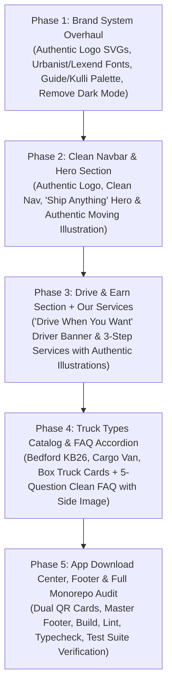

# Kulli Landing Page — Redesign Architecture & Phased Implementation Plan

> **Document Status:** Revised Architectural Plan (No code changes implemented in this turn)
> **Target Workspaces:** `docs/brand` (Brand System) & `apps/landing` (Landing Page)
> **Source of Truth Reference:** `/home/dawit/Documents/Projects/mobile-app/guide/Kulli` & User Uploaded Brand Mark
> **Engineering Standards:** `docs/dev/AGENTS.md`  

---

## 1. Executive Summary & Design Pivot

The initial landing page prototype suffered from over-engineering: artificial glowing indicators, complex multi-colored radar badges, unwanted light/dark mode switching, and an unapproved abstract "Kinetic K" logo.

The user has explicitly directed a return to their **authentic, original design and brand identity** found in `/home/dawit/Documents/Projects/mobile-app/guide/Kulli` and the uploaded logo asset:
1. **The Authentic Logo:**
   - The delivery truck vector silhouette with royal navy outline (`#04009A` / `#1F3B87`) and soft sky blue cargo package (`#77ACF1`).
   - The wordmark `K U L L I` with a warm amber-orange `K` (`#FFAD61`) and deep royal blue `U L L I` (`#1F3B87`).
2. **The Authentic Color Palette:**
   - Primary Royal Blue: `#1F3B87`
   - Deep Midnight Blue: `#142553`
   - Vibrant Honey-Amber Orange: `#FFAD61`
   - Sky Blue Parcel Accent: `#77ACF1` / `#B0E0E6`
   - Clean Background White: `#FFFFFF`
   - Subtle Card Off-White: `#FBFAF9` / `#F8FAFC`
   - Clean Slate Borders: `#E2E8F0` / `#CBD5E1`
3. **No Dark Mode / No Glows:**
   - Single, clean, airy, high-contrast light theme.
   - Eliminate all glowing red/green dots, artificial status pills, and dark mode toggles.
4. **Natural, Concise Copy:**
   - Direct, authentic messaging from `/guide/Kulli`: *"Ship Anything, Anytime, Everywhere with Kulli"* and *"Drive when you want, Make Extra money"*.
   - Zero bloated buzzwords or simulated broker charts.
5. **Authentic Assets:**
   - Ingest the actual illustrated imagery and vehicle photos already present in `/guide/Kulli/public/New photos/`.

---

## 2. Brand System Overhaul Specification (`docs/brand`)

Before changing the landing page, the brand foundation in `/docs/brand` will be aligned with the authentic logo and tokens:

### 2.1 Logo System (`docs/brand/logos/`)
- `kulli-logo-primary.svg`: Horizontal lockup — Vector delivery truck mark + `KULLI` wordmark (Orange `K`, Blue `ULLI`).
- `kulli-logo-stacked.svg`: Centered stacked lockup — Delivery truck on top, `KULLI` below.
- `kulli-logo-mark.svg`: Standalone delivery truck icon (Blue outline + sky blue parcel).
- `kulli-wordmark.svg`: Pure typographic wordmark (`K` in `#FFAD61`, `ULLI` in `#1F3B87`).
- `favicon.svg`: Vector icon of the delivery truck mark.
- Monochrome variants for high-contrast single-color reproduction.

### 2.2 Typography
- Primary Display & Headings: `Urbanist` (from `/guide/Kulli`), clean geometric sans with 800/700/600 weights.
- Body & Buttons: `Lexend` / `Urbanist`, highly legible, modern spacing.
- Download licensed `.woff2` files for `Urbanist` and `Lexend` into `docs/brand/fonts/`.

### 2.3 Design Tokens (`docs/brand/design-tokens.json` & `css/`)
- Remove all dark theme tokens and contrast overrides.
- Establish clean semantic tokens:
  ```json
  {
    "color": {
      "brand": {
        "primary": "#1F3B87",
        "secondary": "#142553",
        "accent": "#FFAD61",
        "parcel": "#77ACF1"
      },
      "surface": {
        "base": "#FFFFFF",
        "subtle": "#FBFAF9",
        "muted": "#F1F5F9"
      },
      "text": {
        "primary": "#1F3B87",
        "body": "#334155",
        "muted": "#64748B"
      },
      "border": {
        "subtle": "#E2E8F0",
        "strong": "#CBD5E1"
      }
    }
  }
  ```

---

## 3. Section-by-Section Landing Page Structure

The landing page layout is modeled directly after the user's authentic design in `/guide/Kulli`:

```
┌────────────────────────────────────────────────────────────────────────┐
│ 1. NAVBAR: [Truck Icon] KULLI     Book  Drivers  About  FAQ  [Log in] [Sign up]
├────────────────────────────────────────────────────────────────────────┤
│ 2. HERO:                                                               │
│    Left: "Ship Anything, Anytime, Everywhere with Kulli"               │
│          "Efficient, Dependable, and Cost-Effective..."                │
│          [Book Now]  [Sign up]                                         │
│    Right: Authentic Home Moving Truck Illustration                     │
├────────────────────────────────────────────────────────────────────────┤
│ 3. DRIVE & EARN (Supply Side):                                         │
│    Left: Driver in Cabin Illustration                                  │
│    Right: "Drive when you want, Make Extra money"                      │
│           [Get Started]  [Sign in]                                     │
├────────────────────────────────────────────────────────────────────────┤
│ 4. OUR SERVICES:                                                       │
│    Left: Delivery Truck Illustration                                   │
│    Right: "All moves can be scheduled in advance, or same day!"       │
│           (1) Home and Office Moves                                    │
│           (2) B2B Logistics                                            │
│           (3) Construction and Jobsites                                │
│           [Learn more]                                                 │
├────────────────────────────────────────────────────────────────────────┤
│ 5. TRUCK TYPES (Fleet Showcase):                                       │
│    "Delivery & Moving on Demand"                                       │
│    [Card 1: Pickup Truck]  [Card 2: Cargo Van]  [Card 3: Box Truck]    │
│    (With authentic photos: Bedford KB26, Cargo Van, Box Truck)         │
├────────────────────────────────────────────────────────────────────────┤
│ 6. FREQUENTLY ASKED QUESTIONS:                                         │
│    Left: 5 Clean Accordion Questions (+ / −)                           │
│    Right: Authentic Moving Boxes Image                                 │
├────────────────────────────────────────────────────────────────────────┤
│ 7. IT'S EASIER IN THE APPS:                                            │
│    "It’s easier in the apps"                                           │
│    [Card 1: Kulli Customer App + QR]  [Card 2: Driver App + QR]       │
├────────────────────────────────────────────────────────────────────────┤
│ 8. CLEAN FOOTER:                                                       │
│    [Truck Icon] KULLI  |  Book  Drivers  About  FAQ  Download App      │
│    Social Links  |  © 2025 Kulli • Privacy Policy • Terms of Service   │
└────────────────────────────────────────────────────────────────────────┘
```

---

## 4. Phased Implementation Roadmap

To ensure zero regressions, clean verification, and adherence to `docs/dev/AGENTS.md`, the redesign is broken down into **5 clear, sequential phases**:



### Phase 1: Brand System Overhaul (`docs/brand`)
- **Objectives:**
  1. Generate authentic vector SVGs in `docs/brand/logos/` matching the user's truck outline + orange-K wordmark.
  2. Download `Urbanist` and `Lexend` variable `.woff2` font files to `docs/brand/fonts/`.
  3. Rewrite `docs/brand/design-tokens.json` and `docs/brand/css/` with the exact color palette (`#1F3B87`, `#142553`, `#FFAD61`, `#77ACF1`, `#FFFFFF`, `#FBFAF9`).
  4. Remove all dark-mode code and glowing status tokens.
  5. Update `docs/brand/showcase.html` to demonstrate the authentic brand.
- **Verification:**
  - SVGs render with exact paths and colors.
  - WOFF2 fonts load without network dependencies.
  - Zero linter or token errors.

---

### Phase 2: Clean Navigation & Hero Section (`apps/landing`)
- **Objectives:**
  1. Ingest updated brand assets into `apps/landing/public/` (logos, fonts).
  2. Copy authentic hero illustration from `/guide/Kulli/public/New photos/concepto de mudanza de casa de diseño plano con camión _ vector gratis (1)-600w.jpg`.
  3. Redesign the sticky navbar:
     - Authentic truck logo + `Kulli` (Orange K).
     - Clean nav links: `Book`, `Drivers`, `About`, `FAQ`.
     - `Log in` (outline pill) and `Sign up` (solid blue pill).
     - Remove the dark mode toggle button completely.
  4. Redesign the Hero section:
     - Headline: *"Ship Anything, Anytime, Everywhere with <span style="color:#FFAD61">Kulli</span>"*.
     - Subtitle: *"Efficient, Dependable, and Cost-Effective On-Demand Delivery and Moving Services for Businesses and Individuals Nationwide."*
     - Clean CTAs: *"Book Now"* and *"Sign up"*.
     - Clean layout without glowing dots or complex simulated map clutter.
- **Verification:**
  - Responsive down to 320px mobile.
  - `npm run build:landing` passes cleanly.

---

### Phase 3: Drive & Earn Section & Our Services Section (`apps/landing`)
- **Objectives:**
  1. Ingest driver cabin illustration from `/guide/Kulli/public/New photos/driving11917-cudg-600w-1200w.png`.
  2. Ingest shipment truck illustration from `/guide/Kulli/public/New photos/shipmenttruckillustration111563-tocb-700w-1200w.png`.
  3. Implement **Section 2 (Drive & Earn)**:
     - 2-column layout: Driver illustration on left, value proposition on right.
     - Headline: *"Drive when you want, Make <span style="color:#FFAD61">Extra</span> money"*.
     - Subtitle: *"Earn money on your schedule by using your truck to transport loads for nearby customers in need of shipping services."*
     - CTAs: *"Get Started"* and *"Sign in"*.
  4. Implement **Section 3 (Our Services)**:
     - 2-column layout: Shipment truck illustration on left, 3 numbered service steps on right:
       - Step 1: **Home and Office Moves**
       - Step 2: **B2B Logistics**
       - Step 3: **Construction and Jobsites**
     - CTA button: *"Learn more"*.
- **Verification:**
  - Semantic structure, clean CSS styling matching `/guide/Kulli/index.css`.
  - Responsive stacking on mobile devices.

---

### Phase 4: Truck Types Catalog & FAQ Accordion (`apps/landing`)
- **Objectives:**
  1. Ingest real vehicle images:
     - Bedford KB26 pickup (`bedfordkb2612459-btob-300h-200h.png`).
     - Delivery cargo van (`deliveryvanwithopendoorandhome12352-ohwn-300h-200h.png`).
     - Box truck / Isuzu flatbed (`New photos/major differences between local moving and long distance moving _ zip moving & storage-1200w.jpg`).
  2. Implement **Truck Types Section**:
     - Eyebrow: `Truck Types`
     - Headline: *"Delivery & Moving on Demand"*
     - 3 Clean, well-spaced vehicle cards with images, titles, and concise descriptions matching `/guide/Kulli`.
  3. Implement **FAQ Section**:
     - 2-column layout: Left has FAQ heading + 5 clean accordion questions with smooth `+` / `−` toggles; Right has the moving boxes image.
     - 5 Real questions:
       1. *How do I book a truck?*
       2. *Is Kulli available in my area?*
       3. *Can I track my shipment in real time?*
       4. *Do you have an iOS or Android app?*
       5. *How do I register as a truck owner?*
- **Verification:**
  - Accessible keyboard navigation (`Enter` / `Space` to expand/collapse).
  - No flickering or layout shifts.

---

### Phase 5: App Download Center, Clean Footer & Monorepo Audit (`apps/landing`)
- **Objectives:**
  1. Ingest QR code illustration from `/guide/Kulli/public/New photos/image5webappswhichshowushowtomakeuseofqrcodesdiffe2914-r9cj-200h-300w.png`.
  2. Implement **App Download Section**:
     - Headline: *"It’s easier in the apps"*
     - 2 Clean Cards:
       - Customer App Card: QR image, *"Download the Kulli app"*, *"Scan to download"*.
       - Driver App Card: QR image, *"Download the Driver app"*, *"Scan to download"*.
  3. Implement **Clean Master Footer**:
     - Authentic logo: `[Truck Icon] KULLI`.
     - Navigation links: `Book`, `Drivers`, `About`, `FAQ`, `Download App`.
     - Clean SVG social icons (Facebook, Twitter, Instagram, LinkedIn, YouTube).
     - Copyright row: `© 2025 Kulli` • `Privacy Policy` • `Terms of Service`.
  4. Update test suite `apps/landing/test/landing.test.mjs` to validate all new authentic elements.
  5. Run full monorepo verification:
     - `npm run lint`
     - `npm run typecheck`
     - `npm test`
     - `npm run verify:startup`
     - `npm run build:landing`
- **Verification:**
  - Zero regressions across API, Admin, and Landing workspaces.
  - Git tree clean and properly committed.

---

## 5. Summary of What Changes vs. What Stays

| Component / Feature | Previous Generated Attempt | Redesigned Plan (Based on `/guide/Kulli`) |
| :--- | :--- | :--- |
| **Brand Logo** | Abstract "Kinetic K" box | **Authentic delivery truck silhouette + `KULLI` (Orange K, Blue ULLI)** |
| **Color Scheme** | Orange 500, Navy 900, Slate 500 | **Royal Blue `#1F3B87`, Midnight `#142553`, Warm Honey Amber `#FFAD61`, Sky Blue `#77ACF1`** |
| **Theme Modes** | Light & Dark mode switcher | **Single, clean, high-contrast Light Theme** |
| **Visual Accents** | Glowing green/red dots, radar badges | **Clean, flat, professional illustrations and cards from `/guide/Kulli`** |
| **Hero Section** | Heavy rate calculator widget with radar pills | **Clean 2-column hero: *"Ship Anything, Anytime, Everywhere with Kulli"*, *"Book Now"* & *"Sign up"* CTAs, moving truck illustration** |
| **Typography** | Plus Jakarta Sans & Space Grotesk | **Urbanist & Lexend (matching user's fonts)** |
| **Copy & Text** | Generated corporate filler | **Concise, direct, authentic copy from `/guide/Kulli`** |
| **Images** | Generated SVGs | **Original authentic imagery from `/guide/Kulli/public/New photos/`** |

---

## 6. Next Step

Awaiting your confirmation on this detailed plan. Once approved, we will begin with **Phase 1: Brand System Overhaul** to build the authentic logo SVGs, color tokens, and font setup.
